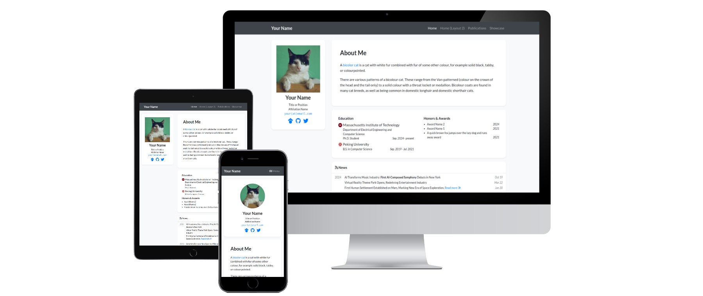
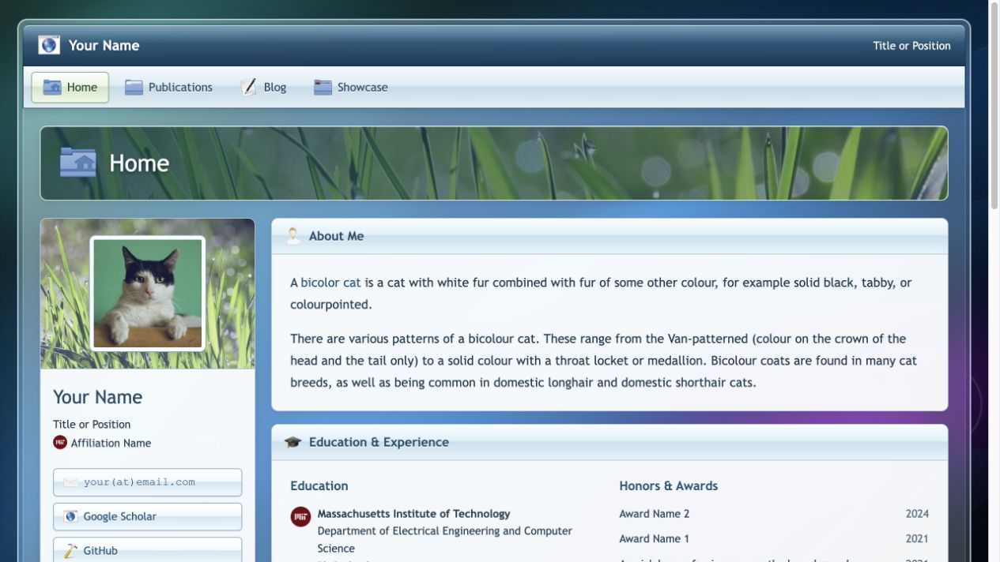
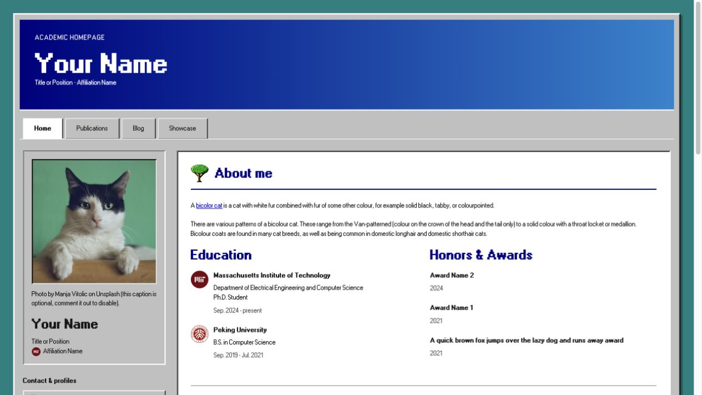

# Siqi Zhong — Academic Homepage

基于 [luost26/academic-homepage](https://github.com/luost26/academic-homepage) 的 Jekyll 个人学术主页。

线上地址：https://zsq0216.github.io/

## 更新内容

- `_data/profile.yml`：姓名、邮箱、简介、教育与奖项。
- `_publications/2025/`、`_publications/2026/`：论文条目；`selected: true` 显示在首页。
- `_data/authors.yml`：作者名加粗设置。
- `_data/projects.yml`：首页和 Projects 页展示的研究项目。
- `assets/images/photos/portrait.jpg`：个人照片。
- `_data/navigation.yml`：导航栏。
- `_config.yml`：站点配置。个人主页的 `baseurl` 应保持为空字符串。

## 本地运行

安装 Ruby 和 Bundler 后执行：

```sh
bundle install
bundle exec jekyll serve
```

访问 http://localhost:4000/ 。推送至 `main` 后，由仓库现有 GitHub Pages 构建流程发布，无需另建仓库。

## 资料说明

内容来自本人提供的简历目录，论文链接已根据 ACM、arXiv 和官方代码仓库核对。博士毕业时间为预计时间。未采用简历中的其他作者模板简介、导师或论文数量声明。Google Scholar 使用本人确认的 `2MhT_MQAAAAJ` 主页；原简历 PDF 含模板姓名，因此暂不提供下载。

模板示例新闻、博客、Showcase 和 2023/2024 示例论文通过 `_config.yml` 的 `exclude` 排除，不会发布为个人成果。模板原始文件保留，便于未来扩展。

---

## Upstream template documentation

# academic-homepage

[](https://luost26.github.io/academic-homepage/)

[](https://github.com/luost26/academic-homepage/actions/workflows/pages/pages-build-deployment)
[](https://hits.sh/github.com/luost26/academic-homepage/)
[](https://github.com/luost26/academic-homepage)
[](https://github.com/luost26/academic-homepage/forks)
<!--[](https://validator.nu/?doc=https%3A%2F%2Fluost26.github.io%2Facademic-homepage)-->

A GitHub Pages (Jekyll) template for personal academic website. Click [here](https://luost26.github.io/academic-homepage/) to see the demo.

## Variants

Explore alternative visual styles in their own repositories.

| Variant | Style | Preview | Links |
| --- | --- | --- | --- |
| Frutiger Aero | Vista-inspired frosted glass, glossy icons, and nature imagery. |  | [Repository](https://github.com/luost26/academic-homepage-frutiger-aero) · [Live demo](https://luost26.github.io/academic-homepage-frutiger-aero/) |
| Nostalgia 1990s | Windows 95/98-style silver bevels, native classic icons, and pixel-grid typography. |  | [Repository](https://github.com/luost26/academic-homepage-nostalgia-1990s) · [Live demo](https://luost26.github.io/academic-homepage-nostalgia-1990s/) |

## User Community

[🏡](https://luost.me/)
[:star:](https://cch1999.github.io/)
[:star:](https://kyrrego.github.io/)
[:star:](https://ced3-han.github.io/)
[:star:](https://lihengchen.com/)
[:star:](https://hpwang-whu.github.io/)
[:star:](https://zhang-yingyi.github.io/)
[:star:](https://wby24.github.io/)
[:star:](https://pengfeixu.com/)
[:star:](https://boqiuphd.github.io/)
[:star:](https://www.huabing.li/)
[:star:](https://xiecuiying.github.io/)
[:star:](https://hannyang.github.io/)
[:star:](https://king-play.github.io/)
[🤖](https://andrewcwlee.github.io)
[:star:](https://laiyao1.github.io)
[🌜](https://tmsultan.github.io)
[🚀](https://zaxguo.github.io)
[:gemini:](https://hongyang-du.github.io)
[:star:](https://thuanz123.github.io)
[🧬](https://gdalba.github.io/)
[:star:](https://yhhan.com/)
[🌔](https://chen-huaneng.github.io/academic)
[:star:](https://jwklee.github.io/)
[😼](https://onethousandwu.com/)
[🔬](https://kwen-chen.github.io/)
[🧑‍🔬](https://shengxiang-lin.github.io/)
[🗣️](https://henry-h22.github.io/)
[🍠](https://xingyuliuxyl.com/)
[:star:](https://melanthera-biflora.github.io/)

:hugs: Feel free to tell us if you are using this template for your website by creating an issue [here](https://github.com/luost26/academic-homepage/issues/new?assignees=&labels=&projects=&template=user-report.md&title=I+am+using+this+template%21).

### Acknowledgements

The improvements of this template have been inspired by the customizations and feedbacks from the following users:
- 😼 [onethousandwu.com](https://onethousandwu.com/): increased corner radius [[Repo]](https://github.com/oneThousand1000/oneThousand1000.github.io)
- :star: [shiwonkim.github.io](https://shiwonkim.github.io/): two-column main page layout [[Repo]](https://github.com/shiwonkim/shiwonkim.github.io)
- :star: [yqxie99.github.io](https://yqxie99.github.io/): blog feature [[Repo]](https://github.com/YQXie99/YQXie99.github.io/tree/feat/add_blog_page)
- :star: [kwen-chen.github.io](https://kwen-chen.github.io/): blog feature [[Repo]](https://github.com/Kwen-Chen/Kwen-Chen.github.io)

## Need Help?

If you run into **any** issues while using this template, or have suggestions for improvements, please don't hesitate to create an issue [here](https://github.com/luost26/academic-homepage/issues/new).

### FAQs

- [Need blogging feature?](https://github.com/luost26/academic-homepage/issues/13#issuecomment-2646371324)
- [How to show citation count for papers?](https://github.com/luost26/academic-homepage/issues/29#issuecomment-3222496187)


## Getting Started

1. First, click the "Use this template" button to create a new repository. The name of the repository should be `<your-github-username>.github.io` (click [here](https://docs.github.com/en/pages/getting-started-with-github-pages/about-github-pages#types-of-github-pages-sites) to learn more about naming a GitHub Pages repository).

### Running Locally (Debug & Preview)

2. Follow the **step 1** and **step 2** of the instruction [here](https://jekyllrb.com/docs/) to install prerequisites and jekyll.

3. Clone your forked repository to your local machine.

4. Run the following command in the root directory of the repository:

   ```bash
   bundle exec jekyll serve
   ```

5. Browse to the displayed URL to see the website.


### Deploying to GitHub Pages

2. Go to the repository settings and enable GitHub Pages. Detailed instructions can be found [here](https://docs.github.com/en/pages/getting-started-with-github-pages/creating-a-github-pages-site#creating-your-site).

3. Navigate to your created website, and follow the instructions displayed on the homepage (if any) to finalize the setup.

